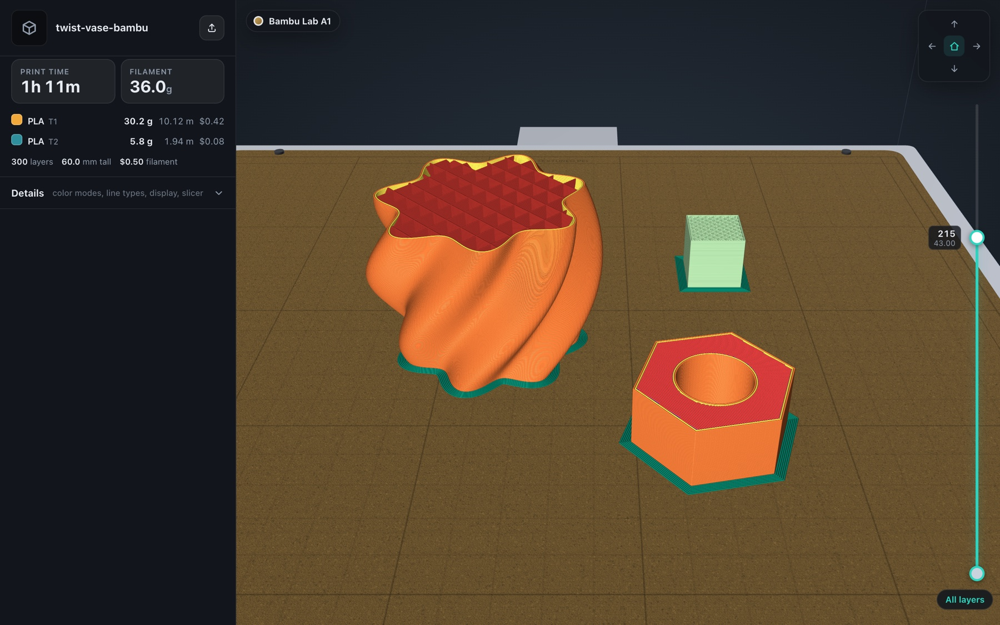
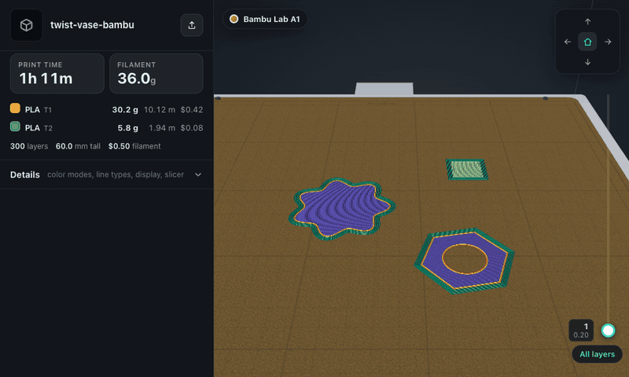
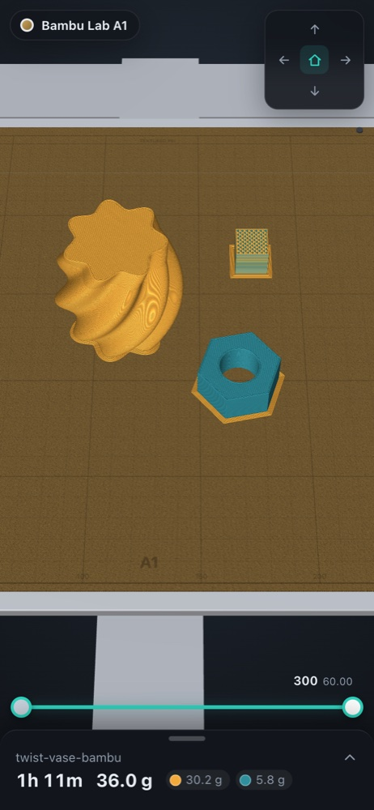
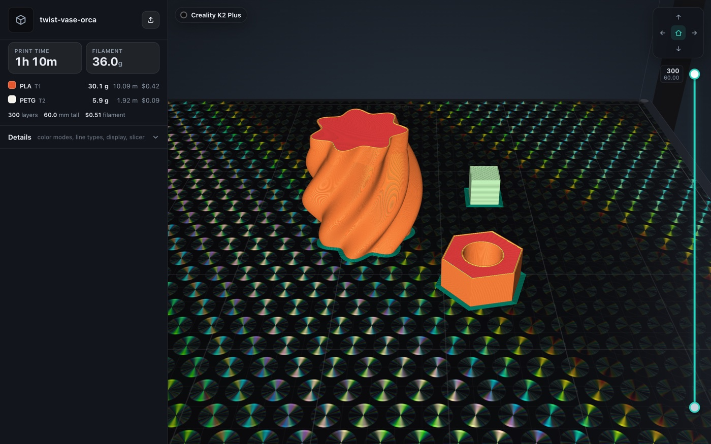

# Print Preview

**See exactly what your printer is about to print, on your phone, before you hit Print.**

Drop in a sliced `.gcode`, `.gcode.gz` or `.gcode.3mf` and Print Preview draws every extrusion as a shaded
tube on a 3D model of your printer's build plate, with print time, filament weight and grams per color up
top. It runs entirely in the browser, parses a 70 MB file in about a second, and one command turns any
G-code into a shareable link that opens straight into the model.

**Try it:** [sleek-nirvana-3mxh.here.now](https://sleek-nirvana-3mxh.here.now/). Generate a sample file with
`npm run sample` or drop in your own.



<table>
<tr>
<td width="62%"></td>
<td width="38%"></td>
</tr>
<tr>
<td colspan="2"></td>
</tr>
</table>

<sub>Every image above is the procedural sample plate from <code>scripts/sample-gcode.ts</code>: generated from formulas, no slicer or model involved.</sub>

## Features

- **The real plate.** A Creality K2 Plus gets its black PEI in a dark enclosure, a Bambu Lab A1 gets the
  bronze plate on its bed slinger, and anything else gets a plate sized from the G-code header. Smooth PEI
  plates render as holographic film whose rainbow shifts as you orbit.
- **Slicer-accurate preview.** Line types, widths and layer heights come from the slicer's own annotations,
  in the colors you already know from Bambu Studio, OrcaSlicer and Creality Print.
- **Glanceable numbers.** Print time (the slicer's figure, with a Klipper-style planner behind it for per-layer
  timing), total grams, grams and cost per color, layer count and height.
- **Eleven color modes.** Line type, filament, speed, layer height, line width, flow, layer time (linear or
  log), fan, temperature and acceleration, each with a legend.
- **Inspect anything.** Drag a two-handle layer range, hide line types, show travels and retractions, ghost
  the layers below, and tap any line for its speed, flow, width, fan, temperature and acceleration.
- **Built for phones.** Bottom-sheet layout, one-finger orbit, pinch zoom, and a camera pad for top, front
  and side views.
- **Preview links.** `scripts/share.sh print.gcode` (or the in-app button) publishes a standalone 14-day link
  that unfurls in chat apps with a render of the print on its plate.
- **Agent-ready.** A packaged skill lets a coding agent turn a freshly sliced file into a link and report
  the print time and grams in one step.

## Supported slicers and files

| | |
|---|---|
| **Slicers** | Bambu Studio, OrcaSlicer, Creality Print, PrusaSlicer, SuperSlicer, Cura |
| **Firmware** | Marlin, Klipper (`SET_VELOCITY_LIMIT`, `START_PRINT` macros), Bambu |
| **G-code** | `G0`–`G3` including arcs, absolute and relative E, `G92`, tool changes, temps, fans, `M204` |
| **Files** | `.gcode`, `.gcode.gz`, `.gcode.3mf` / `.3mf` / `.zip` (multi-plate aware) |
| **Printers** | Creality K2 Plus, Bambu Lab A1, plus a generic plate for any bed size |

Details for each slicer's annotations are in [docs/slicers.md](docs/slicers.md).

## Quickstart

Node 22.18 or newer.

```sh
git clone https://github.com/joey12725/3d-print-visualizer.git
cd 3d-print-visualizer
npm ci
npm run sample     # writes samples/twist-vase-{bambu,orca,prusa,cura}.gcode
npm run dev        # open http://localhost:5173 and drop a sample in
```

```sh
npm test           # parser, every slicer flavor, colors, pricing, file opening
npm run check      # svelte-check, 0 errors and 0 warnings
npm run build      # dist/index.html, one self-contained file you can host anywhere
```

To publish preview links, add a [here.now](https://here.now) API key and run `scripts/share.sh print.gcode --json`:

```json
{ "url": "https://…here.now/", "printTime": "2h 45m 41s", "filamentGrams": 33.5, "filamentGramsPerColor": [33.49], "expiresAt": "…" }
```

## How it works

```
file ─► worker: source.ts (gz / 3mf / zip) ─► parser.ts ─► typed arrays ─(transfer)─► app state
                                                                                        │
                                Stage ─► viewer.ts (three.js) + printers.ts + colors.ts ┘
```

- **Streaming parser.** A Web Worker decompresses and parses the file in chunks and never builds one giant
  string. Moves land in growable typed arrays that are handed to the main thread without a copy.
- **Time model.** A lookahead planner with square-corner velocity, centripetal limits and trapezoid profiles,
  calibrated per layer against the slicer's `;TIME_ELAPSED` marks when present, or against its total.
- **Instanced tubes.** Each extrusion is a GPU instance; a vertex shader expands it into a tube with a diamond
  cross-section and pointed caps. Layer range, ghosting and hidden line types are uniforms, so dragging the
  slider never rebuilds a buffer. Picking renders instance IDs into a 1×1 target.
- **Procedural printers.** Plates, grids, labels and PEI grain are canvas textures and bump maps; the
  holographic film is a patched `MeshStandardMaterial`.
- **Self-contained build.** Vite and `vite-plugin-singlefile` inline everything into one `index.html`, which is
  what lets each preview link carry its own copy of the viewer.

More in [docs/architecture.md](docs/architecture.md).

## Tech stack

TypeScript, Svelte 5 (runes), three.js with custom GLSL, Vite, Vitest, fflate, and the here.now API for
preview links.

## Docs

| Doc | Covers |
|---|---|
| [docs/architecture.md](docs/architecture.md) | parser, renderer, UI, build |
| [docs/slicers.md](docs/slicers.md) | slicer annotations, firmware flavors, printers, sample G-code |
| [docs/viewer.md](docs/viewer.md) | every control in the viewer |
| [docs/sharing.md](docs/sharing.md) | preview links, here.now setup, proxy routes, expiry |
| [docs/development.md](docs/development.md) | dev loop, conventions, hosting, agent skill |

## License

[MIT](LICENSE). Built by [Joey Hersh](https://github.com/joey12725).
